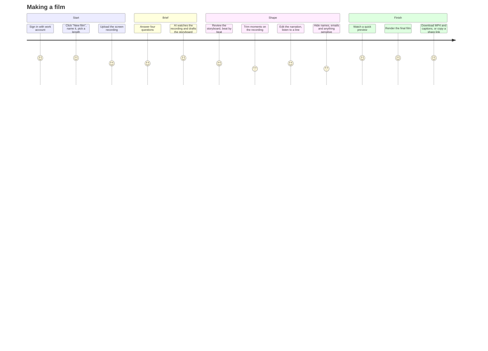

# 01 · Product

## Why it exists

The demo films for the leadership summit worked, and now every team wants
one. Today each film is hand-made by one person, which makes that person the
bottleneck. Showcase Studio lets teams make their own films in the same
style without learning video editing.

**The outcome:** a team with a screen recording of its tool gets a finished,
on-brand film in under 30 minutes of its own time.

## The user

The product is designed around one kind of user, without naming a role
anywhere in the product.

- **Busy and senior:** they will give it 20 to 30 minutes, not an afternoon.
- **Not technical:** they don't know what a codec, frame rate or keyframe
  is, and shouldn't need to.
- **Knows the story:** they can say what problem the tool solves and why it
  matters, in a sentence or two.
- **Cares how it looks:** the film goes in front of senior audiences, so it
  must look professional on the first try.
- **Owns the content:** they are accountable for what the film shows, so
  they need to review every word and hide anything sensitive.

**Design implications:**
- Every screen has one obvious next step.
- Defaults are good enough to publish.
- AI drafts, the user decides.
- Use plain words: "your recording", "your film", "hide this area". Never
  "asset", "render job" or "keyframe".
- No error codes. When something fails, say what happened and what to do.

## What a film is

Every film follows the structure that tested best, which is in the house
style:

| Beat | Purpose | Typical length |
|---|---|---|
| **Title** | Name of the tool and a one-line promise | 3 s |
| **The problem** | What is slow, hard or invisible today | 10 to 20 s |
| **The answer** | Introduce the tool | 3 to 5 s |
| **How it works** | Two or three moments from the recording | 20 to 60 s |
| **The result** | The outcome or number, said simply | 8 to 15 s |
| **End card** | Name, tagline, and the brand mark | 5 s |

Templates set the target length: **Short (about 60 s)**, **Standard (about
90 s)** and **Full (about 120 s)**.

## User journey

### Step by step

1. **Home: "Your films."** Shows a grid of the user's films, each with its
   status (Draft, Rendering, Ready), and a big **New film** button.
2. **New film.**
   - The user enters a name (the tool's name) and picks a length (Short,
     Standard or Full).
   - Optionally they pick an accent colour from the brand palette.
   - They upload the recording: MP4 or MOV, up to 2 GB and 15 minutes. The
     upload goes straight to storage with a progress bar, and the user can
     carry on with step 3 while it uploads.
3. **The brief: four questions,** each with an example under it:
   1. *What problem does this tool solve?* ("Checking contract obligations
      is manual, so broken promises rarely become claims.")
   2. *What does it do, in one sentence?*
   3. *What should people remember? Is there a result or a number?*
   4. *Anything to avoid showing or saying?* (optional)
4. **Drafting.** Shows a calm progress screen ("Watching your recording…
   Drafting the story…"). It usually takes under a minute. Gemini sees the
   recording and the brief, and proposes:
   - the storyboard: beats, the moments to use from the recording, and
     narration for each beat;
   - on-screen text: the title, tagline and up to three callouts;
   - areas that look sensitive (names, emails, account numbers), for the
     user to confirm.
5. **Storyboard.** The main working screen.
   - **Left:** the beats as cards. Each card shows its moment (a
     thumbnail, with in and out points on a mini scrubber), its narration
     text with a ▶ button to hear the line in the film's voice, and any
     callout.
   - **Right:** a live preview of the selected beat, drawn with the same
     film kit the renderer uses, so what users see is what they get.
   - **Users can:**
     - trim a moment;
     - swap a moment by choosing one from the recording's timeline strip;
     - rewrite a line, or click **Suggest another** to have AI rewrite
       just that line;
     - add or remove a callout;
     - drag to reorder the how-it-works moments.
   - **Hide this area:** the user draws a box on the preview. The box
     follows the moment, and AI-suggested boxes appear here for a yes or
     no.
   - **Pronunciation:** the user tells the voice how to say a word, for
     example "D2C" as "D to C", while captions keep the written form.
   - A length meter shows the film's running time against the template
     target.
6. **Preview.** A fast draft render (480p, about 1 to 2 minutes) plays in
   the page. The user can go back and change things, or move on.
7. **Final film.** One click starts it.
   - A progress bar shows the time remaining (2 to 5 minutes, because the
     render is split across parallel workers).
   - The user can close the tab: they get an email or Teams message when
     the film is ready.
8. **Ready.**
   - Downloads: the MP4 (1080p), captions as SRT, and a thumbnail (the
     title card).
   - A share link that expires after 30 days, for viewers who are signed
     in.
   - **Duplicate to make a new version**, which keeps the old film.

## Scope

**In v1:**
- Single films from one recording.
- The fixed beat structure, with three lengths.
- The house style, with an accent colour.
- AI drafting with Gemini.
- Google voice, captions, generated score.
- Masking, preview, final render, download and share link.
- Version history.

**Not in v1 (planned for v2):**
- Montages of several films (like the community-call film).
- Several recordings in one film.
- Custom music upload.
- Custom fonts or brands beyond the house style.
- Translation and other narration languages.
- Teams or SharePoint publishing straight from the app.
- An admin dashboard (usage, costs).

**Never:**
- Free-form video editing.
- Filters or transitions beyond the house style.
- Stock footage.
- AI-generated images of real people.

## Screens

| Screen | Main parts |
|---|---|
| Your films | Grid of film cards (thumbnail, name, status, updated), New film |
| New film | Name, length picker, accent swatches, upload drop zone |
| Brief | Four questions with examples, Continue |
| Drafting | Progress steps, cancel |
| Storyboard | Beat cards (left), preview (right), timeline strip (bottom), length meter, Preview button |
| Preview | Player, "Looks good, make the final film", "Back to storyboard" |
| Rendering | Progress, time left, "We'll let you know when it's ready" |
| Ready | Player, Download MP4 / Captions / Thumbnail, Copy share link, Duplicate |

## How we measure success

- **Time to first film:** median under 30 minutes from upload to final
  render.
- **Published as drafted:** 60% or more of films are rendered with only
  light edits to the AI draft.
- **Reliability:** failed renders under 1%. Each one is reported with a
  plain-language reason and retried automatically once.
- **Adoption:** the number of teams making a film each month; the
  bottleneck is gone.
