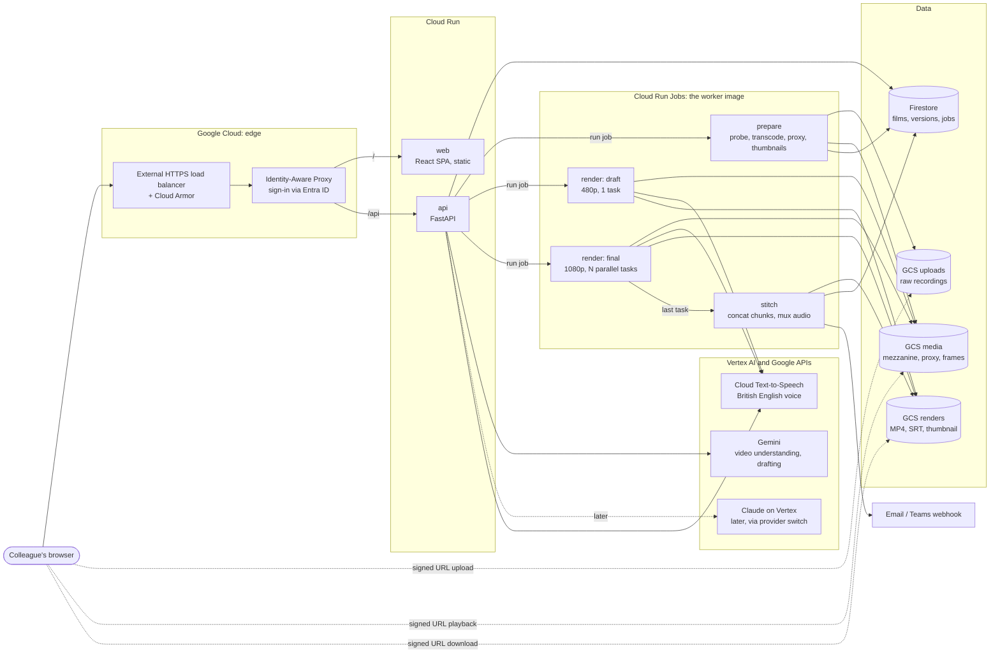
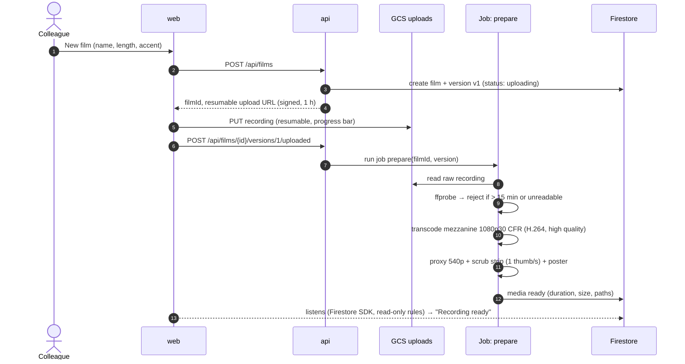
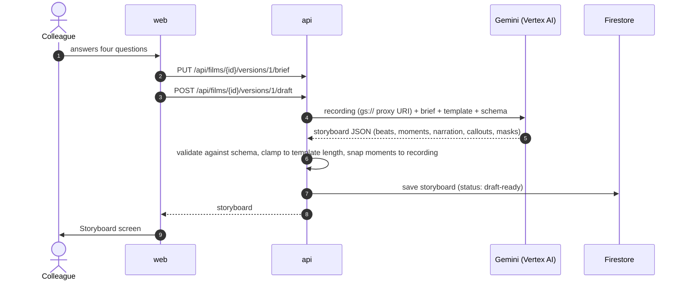
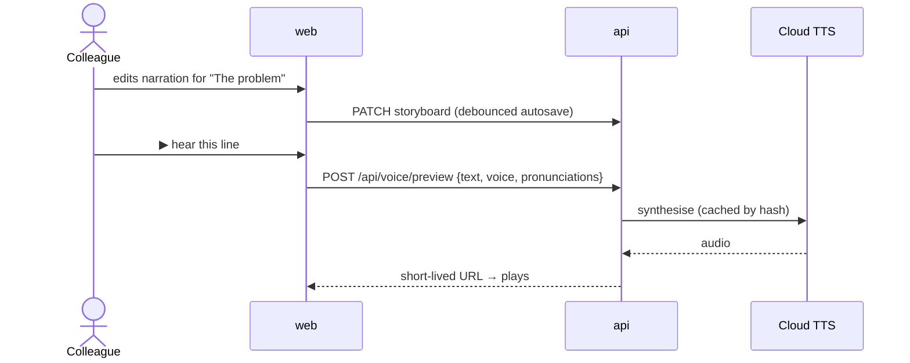
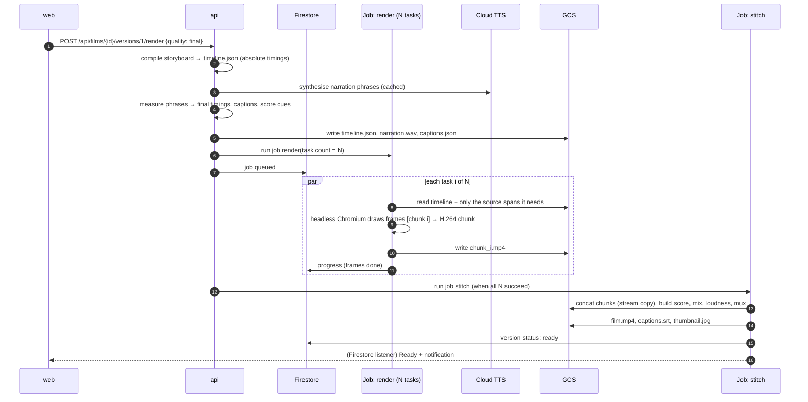
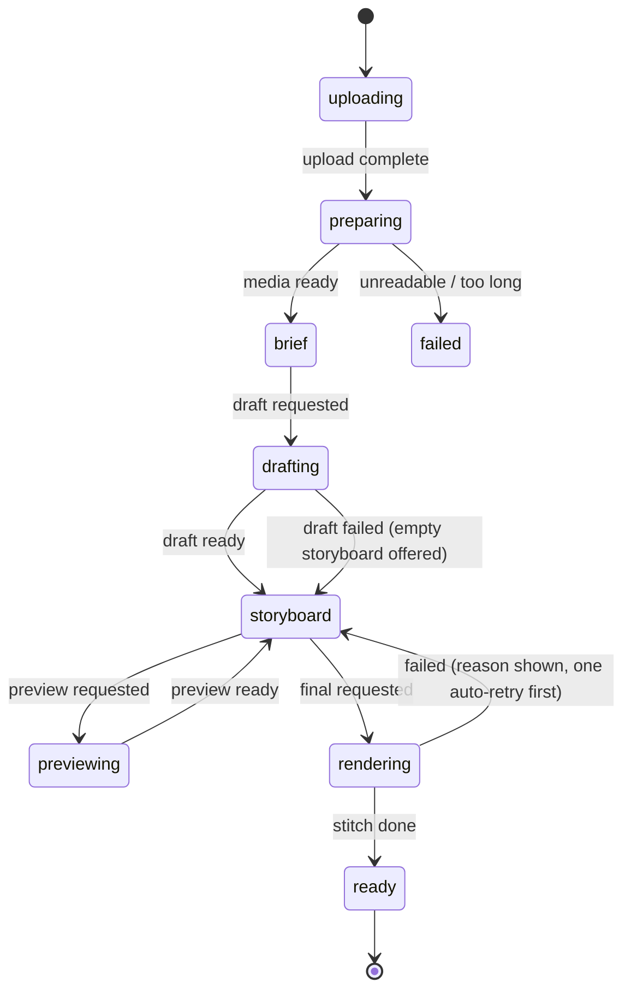

# 02 · Architecture

## The big picture

## Components

| Component | Runs as | Language | Responsibility |
|---|---|---|---|
| **web** | Cloud Run service (nginx serving static files) | TypeScript, React, Vite | All screens. Uploads go straight to storage, and the storyboard editor shows a live canvas preview using `film-kit`. |
| **api** | Cloud Run service | Python, FastAPI | Films and versions (CRUD), signed URLs, the brief, AI drafting, line suggestions, voice preview of one line, starting jobs, job status, share links. Checks the IAP identity on every request. |
| **worker** | Cloud Run Jobs, one image with three modes | Python and Node, with Chromium and ffmpeg | `prepare`: probes and transcodes the upload, makes a proxy and thumbnails. `render`: draft or final; final splits into chunks across tasks. `stitch`: concatenates the chunks, mixes and muxes, writes the outputs. |
| **timeline-schema** | Shared package | JSON Schema, generating TS and Pydantic | The film contract (see `04-render-engine.md`). |
| **film-kit** | Shared package | TypeScript, bundled to one ES module | The house-style canvas effects, ported from `reference/engine/kit.js`. Used by the web preview and the worker's stage page. |
| **audio** | Python module in the worker | Python, numpy | Narration from TTS, phrase pauses, captions, the score generator (ported from `music.py`), ducking, mix and loudness. |

**Why the worker is one image with modes:** `prepare`, `render` and
`stitch` all need ffmpeg, and two of them need Chromium. One image means one
build and one set of patches. Each Cloud Run Job sets its mode, CPU and
memory separately.

## Flow 1: create a film and upload

## Flow 2: brief and AI draft

## Flow 3: edit, then preview a line

## Flow 4: render (final)

**Why chunks:** one browser draws about 6 to 8 frames a second. A 90-second
film at 30 fps is 2,700 frames, so one task takes about 6 minutes, and 6
tasks take about 1 minute. Because frames are a pure function of time
(see the guardrails), a chunk can start at any frame. Chunk boundaries snap
to cut points, so the encoder never splits a scene. Audio is built once, in
`stitch`, so the chunks carry picture only.

**Draft renders** are the same pipeline at 960×540 and 15 fps in one task.
They skip the film grain and use faster encoder settings.

## State machine (per version)

A version that is **ready** can't be changed. **Duplicate** makes a new
version starting from `storyboard`.

## API surface (v1)

| Method and path | Purpose |
|---|---|
| `GET /api/me` | Who am I (from the IAP identity) |
| `GET /api/films` / `POST /api/films` | List my films / create one |
| `GET /api/films/{id}` / `PATCH` / `DELETE` | Read, rename or delete a film |
| `POST /api/films/{id}/versions/{v}/upload-url` | Resumable signed upload URL |
| `POST /api/films/{id}/versions/{v}/uploaded` | Upload done → start `prepare` |
| `PUT /api/films/{id}/versions/{v}/brief` | Save the four answers |
| `POST /api/films/{id}/versions/{v}/draft` | AI draft of the storyboard |
| `GET` / `PATCH /api/films/{id}/versions/{v}/storyboard` | Read or autosave the storyboard |
| `POST /api/films/{id}/versions/{v}/suggest-line` | AI rewrite of one line |
| `POST /api/voice/preview` | Speak one line |
| `POST /api/films/{id}/versions/{v}/render` | `{quality: draft \| final}` |
| `GET /api/films/{id}/versions/{v}/outputs` | Signed URLs for MP4, SRT, thumbnail |
| `POST /api/films/{id}/versions/{v}/duplicate` | New version from this one |
| `POST /api/films/{id}/versions/{v}/share` | 30-day share link (signed-in viewers) |

Status updates come through Firestore listeners in the browser, using
security rules that let a user read only their own films. The API stays
stateless.
