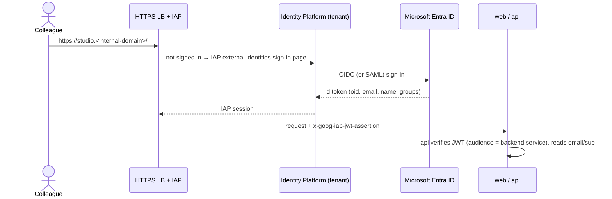

# 06 · Security and data handling

## Sign-in: Entra ID through Identity-Aware Proxy

- **Setup:**
  - IAP with **external identities** (Identity Platform).
  - One tenant with an **OIDC provider pointing at the Vodafone Entra ID
    tenant**: an app registration in Entra, with the redirect URI set to
    the Identity Platform callback.
  - Praga sets up the Entra app registration together with the Entra
    admins (see `07-deploy-gcp.md`).
- **Access:** restrict to an Entra **group** (for example
  `Showcase-Studio-Users`). Map it with an IAP access condition, or check
  the `groups` claim in the API.
- **API:** verify `x-goog-iap-jwt-assertion` on every request (issuer
  `https://cloud.google.com/iap`, audience = the backend service). Reject
  anything else, even from inside the VPC. The user ID is the IAP subject,
  and their email is stored for display.
- **Authorisation:** a user sees and edits only films where they are
  `owner` or in `editors[]`. Share links grant **view-only** access to one
  version, for **signed-in** colleagues, until they expire after 30 days.

## Data

| Data | Where | Retention | Notes |
|---|---|---|---|
| Raw recordings | `gs://<proj>-studio-uploads` | **7 days** (lifecycle rule), then deleted | Only needed until the mezzanine copy exists |
| Mezzanine, proxy, frames, thumbnails | `gs://<proj>-studio-media` | While the film exists. Frames for 3 days. | Frames are temporary render inputs |
| Narration cache | `gs://<proj>-studio-media/tts-cache/` | 90 days | Keyed by hash |
| Final outputs | `gs://<proj>-studio-renders` | While the film exists | MP4, SRT, thumbnail |
| Films, versions, storyboards, jobs | Firestore (Native mode) | While the film exists. Deleting a film deletes everything. | No media in Firestore |

- **Buckets:**
  - Uniform bucket-level access, public access prevention on.
  - CMEK optional (customer-managed encryption keys).
  - All three buckets are in the **same EU region** as Vertex AI and Cloud
    Run.
- **Browser access to media** is only through **V4 signed URLs**:
  - uploads: 1 hour;
  - playback and downloads: 15 minutes;
  - share links mint fresh short URLs on every view.
- **Deleting a film** is a hard delete across Firestore and the three
  buckets, done by a background task. Show it in the UI as "Deleted
  permanently".

## Confidential content in recordings

- The **mask tool** comes before any render. AI suggestions, as described
  in `05-ai-assist.md`, help, but the user is accountable. The UI says so,
  in plain words, on the Preview screen: "Check that nothing confidential is
  visible."
- **Masks are applied during drawing.** No unmasked frame is ever encoded,
  even in drafts.
- **Logs:** request metadata only. Never log narration text, prompts, AI
  responses, file names or URLs with signatures. Cloud Logging is set to
  default retention.
- **Optional DLP:** a setting `DLP_SCAN=true` runs Cloud DLP on the
  narration and on-screen text before a final render, and warns the user
  about personal data.

## Service accounts (least privilege)

| Account | Roles |
|---|---|
| `sa-web` | none (serves static files) |
| `sa-api` | Firestore User. Storage Object Admin on the three buckets. Service Account Token Creator on itself, to sign URLs. Vertex AI User. Cloud Run Jobs Developer, to run executions. |
| `sa-worker` | Firestore User. Storage Object Admin on the three buckets. Cloud TTS is enabled for the project; no extra role is needed beyond API access. |
| `sa-build` | Artifact Registry Writer. Cloud Run Admin (deploy). Service Account User on the runtime service accounts. |

## Web security headers (nginx)

- `Content-Security-Policy`:
  - `default-src 'self'`;
  - `img-src 'self' blob: https://storage.googleapis.com`;
  - `media-src 'self' blob: https://storage.googleapis.com`;
  - `connect-src 'self' https://storage.googleapis.com https://firestore.googleapis.com`;
  - `font-src 'self'`;
  - `frame-ancestors 'none'`.
- Also send `Strict-Transport-Security`, `X-Content-Type-Options: nosniff`
  and `Referrer-Policy: same-origin`.
- No third-party scripts and no analytics in v1.

## Threats considered

| Threat | Mitigation |
|---|---|
| Someone outside the user group reaches the app | IAP in front of everything, a group restriction, and the API verifies the IAP JWT |
| Someone guesses another user's film ID | Ownership check on every route. Firestore rules for the read-only browser listeners. |
| A malicious upload (crafted media) | `prepare` runs ffprobe and ffmpeg in a separate job with no network access except GCS. Size and duration limits. Reject anything that isn't video. |
| Prompt injection through on-screen text in the recording | The model's output is schema-checked data only, never executed. Narration is shown to the user before any render. |
| Leaked share link | It needs sign-in anyway, is view-only, expires in 30 days, and the owner can revoke it |
| Confidential data in a film | Masks, AI suggestions, the Preview warning, optional DLP |
